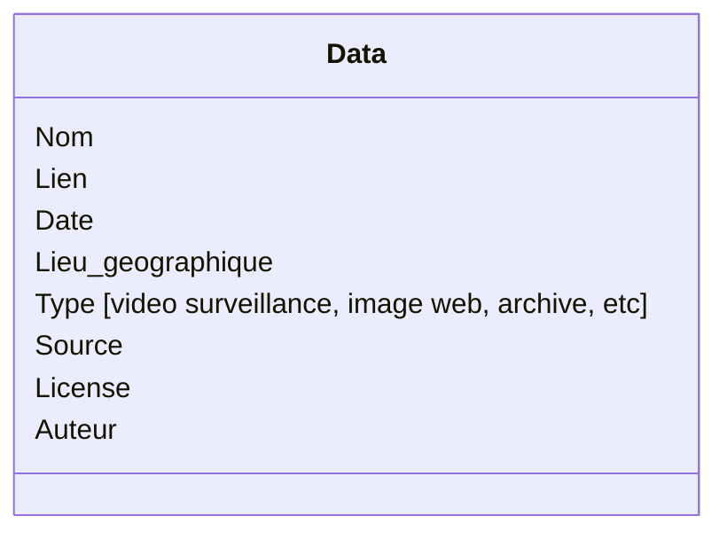

# Data_Visualisation

# Script Python (Poc)
Afin d'avoir un jeu de données de tests, **avec des données aléatoires**, veuillez executer le fichier `gen_date.py`
```bash
python gen_data.py
```


## format des données attendues 


<u>Le type</u> peut etre parmit ces types et d'autres si vous le jugez pertinant : video surveillance, image web, archive, etc".
<u>La source</u> nous donnerais le site/platforme de l'image, par exemple instagram, youtube, arte, etc.
<u>Auteur</u>, une personne, par exemple un artcile de *Le monde* a pour source *Le monde* et comme Auteur le nom de la personne ayant écrit l'article.

Toutes ces données seront attendues en fichier format `.csv`. 
